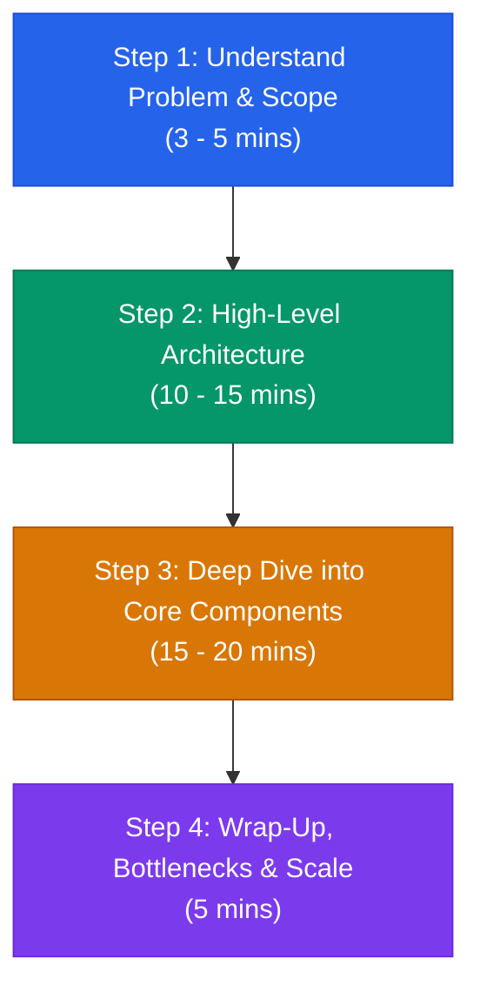
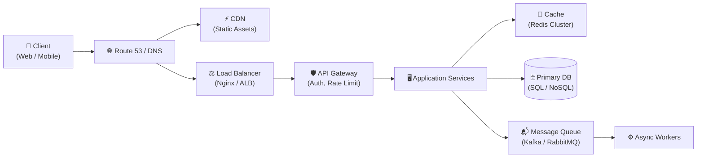
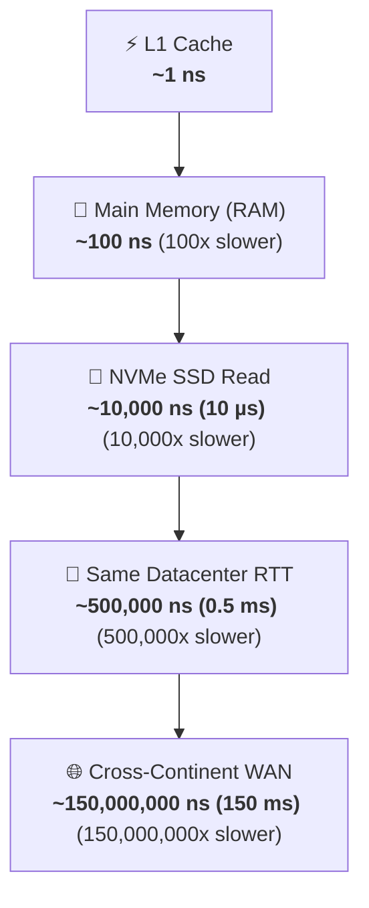

# System Design Interview: Universal 4-Step Framework

> **TL;DR:** A systematic, battle-tested 4-step framework to navigate any system design interview in 45-60 minutes without freezing or jumping straight into implementation details.

---

## 🧭 The 4-Step Interview Progression

---

## Step 1: Understand the Problem & Establish Scope (3–5 mins)

Never jump into drawing boxes right away. Clarify functional and non-functional requirements.

### Key Questions to Ask
- **Functional Requirements:**
  - What are the 2 or 3 core features we must support?
  - Who are the primary users? (End-consumers, internal admins, mobile vs web)
- **Non-Functional Requirements:**
  - **Scale & Traffic:** What is the Daily Active User (DAU) count? Read-to-write ratio?
  - **Latency:** Is sub-100ms response time required?
  - **Availability vs Consistency:** Can we tolerate eventual consistency, or must it be strongly consistent (financial transactions)?
  - **Durability:** Is zero data loss required?

### Back-of-the-Envelope Estimation Rules of Thumb

| Metric | Rough Rule |
| :--- | :--- |
| **Seconds in a day** | $\approx 86,400 \approx 10^5 \text{ seconds}$ |
| **QPS Formula** | $\text{QPS} = \frac{\text{Daily Requests}}{10^5}$ |
| **Peak QPS** | Typically $2\times$ to $5\times$ Average QPS |
| **1 Million requests/day** | $\approx 12 \text{ requests/sec}$ |
| **100 Million requests/day** | $\approx 1,200 \text{ requests/sec}$ |
| **1 Billion requests/day** | $\approx 12,000 \text{ requests/sec}$ |

---

## Step 2: High-Level Architecture (10–15 mins)

Propose an end-to-end blueprint before zeroing in on details.

### Checklist for High-Level Design:
1. **API Endpoints:** Define 2–3 core RESTful/RPC signatures (e.g. `POST /api/v1/urls`, `GET /{short_url}`).
2. **Data Model:** Draft main entities (Users, Posts, Metadata) and primary storage engines.
3. **Core Traffic Flow:** Trace a single request from client to storage and back.

---

## Step 3: Deep Dive into Core Bottlenecks (15–20 mins)

Work with the interviewer on the 2–3 hardest problems specific to this system:
- **Data Partitioning / Sharding:** How to shard when data exceeds single-node capacity?
- **High Concurrency & Contention:** Hot keys, race conditions, distributed locks.
- **Failover & Redundancy:** What happens if the primary database dies? What if cache crashes?

---

## Step 4: Wrap-Up & Production Hardening (5 mins)

Summarize the design and acknowledge trade-offs:
- **Monitoring & Metrics:** Latency p95/p99, error rates, CPU/Memory saturation.
- **Graceful Degradation:** Circuit breakers, fallback responses during outages.
- **Future Improvements:** What would you build next if you had another month?

---

## ⚡ Latency Numbers Every Engineer Should Know

- **L1 cache reference:** $\approx 1 \text{ ns}$
- **Main memory (RAM) reference:** $\approx 100 \text{ ns}$
- **Read 1 MB sequentially from memory:** $\approx 3,000 \text{ ns} \ (3\ \mu\text{s})$
- **Read 1 MB sequentially from SSD:** $\approx 50,000 \text{ ns} \ (50\ \mu\text{s})$
- **Round-trip in same datacenter:** $\approx 500,000 \text{ ns} \ (0.5\ \text{ms})$
- **Send packet CA to Netherlands and back:** $\approx 150,000,000 \text{ ns} \ (150\ \text{ms})$

