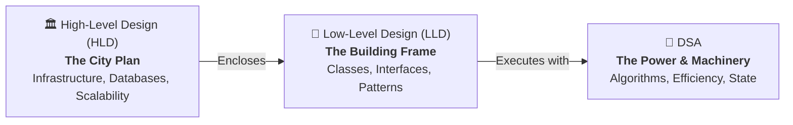
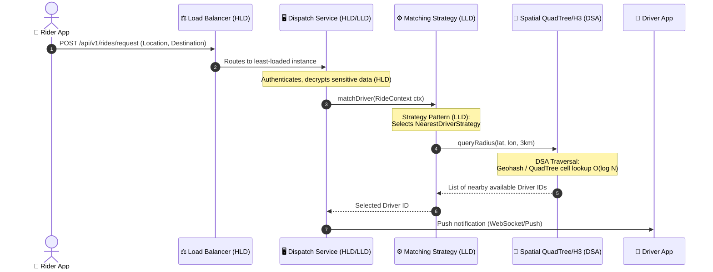

# HLD vs. LLD vs. DSA: The Software Engineering Triad

> **TL;DR:** High-Level Design (HLD) builds the macro system blueprint (servers, databases, network boundaries), Low-Level Design (LLD) sculpts the modular code skeleton (classes, interfaces, design patterns), and Data Structures & Algorithms (DSA) supply the computational muscle (optimal data structures, graph search, time/space complexity). Real-world engineering requires mastering all three in harmony.

---

## 🎯 The Core Problem: Algorithmic Tunnel Vision

Many engineers prepare exclusively for Data Structures and Algorithms (DSA) and approach system design with the same mindset. In an interview or production setting (e.g., designing **Uber** or **Ola**), this leads to a classic failure mode:

```mermaid
flowchart TD
    subgraph CandidateA["❌ Candidate A: DSA Tunnel Vision"]
        A1["Starts immediately with Priority Queue for nearest driver"] --> A2["Implements Dijkstra's algorithm on the whiteboard"]
        A2 --> A3["❌ Fails to identify core entities (Driver, Rider, Trip)"]
        A3 --> A4["❌ Ignores scale (100k writes/sec), DB bottlenecks, and payments"]
        A4 --> A5["❌ Tightly coupled, monolithic code with no plug-and-play extensions"]
    end

    subgraph CandidateB["✅ Candidate B: Holistic Engineering Mindset"]
        B1["1. Clarifies Scale & Non-Functional Requirements"] --> B2["2. Maps Core Entities & Domain Relationships (LLD)"]
        B2 --> B3["3. Designs Resilient Distributed Architecture (HLD)"]
        B3 --> B4["4. Addresses Security, Payments & Failure Domains"]
        B4 --> B5["5. Implements DSA at the exact component where needed"]
    end

    style CandidateA fill:#fee2e2,stroke:#dc2626,color:#991b1b
    style CandidateB fill:#dcfce7,stroke:#16a34a,color:#166534
```



### The Interviewer's Perspective
When asked to design a ride-hailing system like Uber:
- **Candidate A** immediately writes a priority queue to match drivers. The interviewer is dissatisfied because the candidate ignored:
  - How location tracking handles hundreds of thousands of updates per second.
  - How payments, ride state machines, and push notifications are decoupled.
  - How sensitive user and payment data is secured and segregated.
  - How to add new vehicle categories (e.g., Bikes, Luxury, Rentals) without rewriting core logic.
- **Candidate B** first establishes the domain model, decouples services with clean interfaces (plug-and-play), establishes data boundaries, and then applies DSA algorithms precisely where computational optimization is required (e.g., geospatial indexing).

---

## 🏗️ The Three Pillars Analogy



| Dimension | 🏛️ High-Level Design (HLD) | 🦴 Low-Level Design (LLD) | 🧠 Data Structures & Algorithms (DSA) |
| :--- | :--- | :--- | :--- |
| **Metaphor** | The City Blueprint | The Structural Skeleton | The Engine / Muscle |
| **Primary Scope** | Macro-architecture & distributed infrastructure | Object-oriented design, classes & modules | In-memory operations & function complexity |
| **Code Relation** | **Zero code**. Block diagrams, data flows, APIs | **Code structure**. Interfaces, classes, design patterns | **Executable logic**. Loops, pointers, recursion, complexity |
| **Key Concerns** | Scalability, availability, latency, storage, cost | Maintainability, extensibility, testability, loose coupling | Time complexity $O(n)$, space complexity $O(1)$, edge cases |
| **Artifacts** | Architecture diagrams, schemas, data flow pipelines | Class diagrams, UML, Sequence diagrams, SOLID design | Functions, data structures, test cases |
| **Deliverables** | Cloud infra, DB engines, caching layer, brokers | Refactored modules, clean domain models, APIs | Optimized search, sorting, traversal routines |

---

## 🔍 Deep-Dive: The Three Tiers in Action (Uber / Ola Case Study)

Let us examine how a ride request traverses all three layers in production.



### 1. High-Level Design (HLD) Breakdown
- **Responsibility:** How does the entire system stay available, durable, and performant under load?
- **Key Decisions:**
  - **Database Partitioning:** Ride history in Cassandra/ScyllaDB (high write throughput); user billing in PostgreSQL with ACID guarantees.
  - **Location Streaming:** Real-time driver location updates ($100k\text{ updates/sec}$) ingested via Apache Kafka / Redis Pub-Sub.
  - **Cross-Cutting Concerns:** OAuth2 authentication, TLS termination at API Gateway, PCI-DSS compliance for payment card storage.
  - **Cost Optimization:** Auto-scaling server clusters down during off-peak hours (3:00 AM) and up during commute rushes.

### 2. Low-Level Design (LLD) Breakdown
- **Responsibility:** How is the code structured so a team of 50 developers can add features without breaking existing code?
- **Core Principles:**
  - **Loose Coupling & High Cohesion:** The `NotificationService` does not know how `PaymentService` processes credit cards. They communicate via event messages or clean interfaces.
  - **Plug-and-Play Extensibility (Open-Closed Principle):**
    ```java
    // LLD: Strategy Pattern allows adding new matching algorithms 
    // without modifying the core Dispatcher service
    public interface DriverMatchingStrategy {
        Driver match(RideRequest request, List<Driver> candidates);
    }

    public class NearestDriverStrategy implements DriverMatchingStrategy { ... }
    public class HighestRatedDriverStrategy implements DriverMatchingStrategy { ... }
    public class BatchOptimalMatchingStrategy implements DriverMatchingStrategy { ... }
    ```
  - **Domain Entities & State Machines:**
    - Entities: `Rider`, `Driver`, `Vehicle`, `Trip`, `Location`, `Invoice`.
    - State Machine: `TripStatus` $\to$ `REQUESTED` $\to$ `ACCEPTED` $\to$ `ARRIVED` $\to$ `IN_PROGRESS` $\to$ `COMPLETED` $\to$ `PAID`.

### 3. Data Structures & Algorithms (DSA) Breakdown
- **Responsibility:** How does a single process compute the optimal result within millisecond CPU budgets?
- **Core Applications:**
  - **Geospatial Indexing:** Using **QuadTrees**, **Google S2 Geometry cells**, or **Uber H3 hexagons** to search for coordinates in $O(\log N)$ or $O(1)$ rather than scanning millions of drivers ($O(N)$).
  - **Shortest Path & Routing:** Modified **A\* algorithm** or **Contraction Hierarchies** on road networks for estimated time of arrival (ETA).
  - **Bipartite Graph Matching:** Kuhn-Munkres (Hungarian algorithm) for batch matching riders to drivers during peak surges.

---

## ⚖️ Comparison Matrix: HLD vs. LLD vs. DSA

| Attribute | High-Level Design (HLD) | Low-Level Design (LLD) | Data Structures & Algorithms (DSA) |
| :--- | :--- | :--- | :--- |
| **Granularity** | Macro (Subsystems, Networks) | Meso (Classes, Objects, Packages) | Micro (Functions, Memory, Loops) |
| **Primary Goal** | Scalability & Fault Tolerance | Maintainability & Extensibility | Time & Space Efficiency |
| **Key Failure Mode** | Single Point of Failure (SPOF), DB crash | Spaghetti code, tight coupling, regression bugs | Time Limit Exceeded (TLE), memory leak |
| **Guiding Rules** | CAP theorem, PACELC, 12-Factor App | SOLID principles, Gang of Four (GoF) patterns | Big-O notation, amortized analysis |
| **Typical Tools** | Load Balancers, Kafka, Redis, SQL/NoSQL | Java/C++/Go, UML, Design Patterns, DI frameworks | Arrays, Hash Maps, Trees, Graphs, DP |
| **Interview Duration** | 35–45 minutes | 45–60 minutes | 30–45 minutes |

---

## 💡 System Design Interview Takeaways & Red Flags

### 🚩 Red Flags Interviewers Watch For
1. **The DSA Reflex:** Jumping into coding a priority queue or graph traversal before defining entities, clarifying constraints, or sketching system boundaries.
2. **Ignoring Cross-Cutting Concerns:** Forgetting about security, network failure, data privacy, authentication, and idempotency.
3. **Hardcoded Monoliths in LLD:** Writing a single `UberSystem` class with 2,000 lines handling billing, GPS, matching, and notifications in one place.
4. **Tool-Dropping in HLD:** Shouting "use Kafka and Redis" without explaining *why* they fit the throughput, consistency, and eviction requirements.

### 🏆 The Winning Formula
1. **Clarify Scope First:** Ask about read/write volume, latency targets, and core user journeys.
2. **Lay Down Entities (LLD/Domain):** Identify the core actors and data models (`User`, `Trip`, `Payment`).
3. **Map the Architecture (HLD):** Draw the high-level components (API Gateway, services, databases, queues).
4. **Enforce Clean Code Contracts (LLD):** Show how services interact through decoupled interfaces and design patterns (Factory, Strategy, Observer).
5. **Zoom into Algorithms (DSA):** Apply algorithms to the specific high-leverage bottlenecks (e.g., spatial partitioning, routing graphs).

