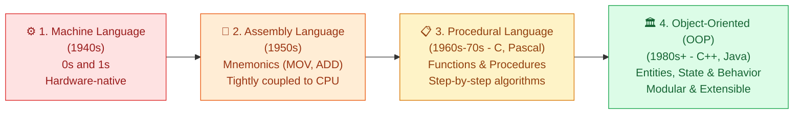
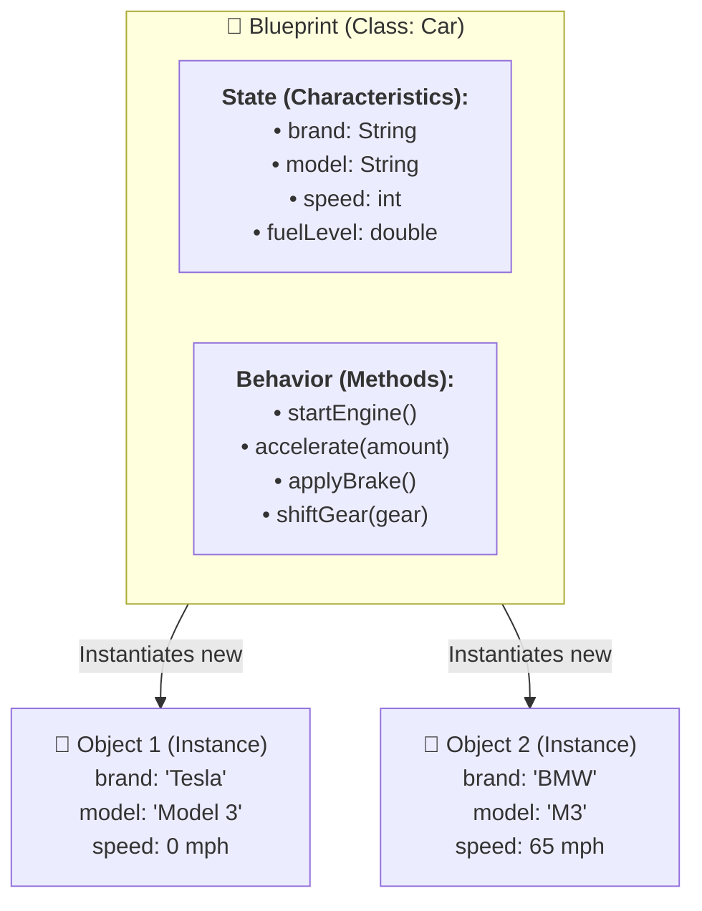
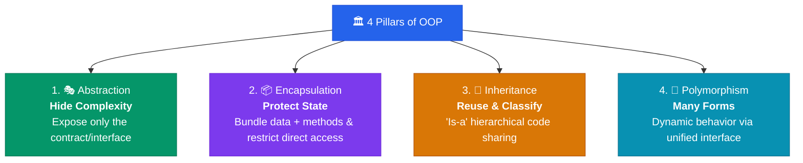
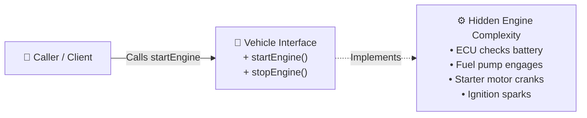
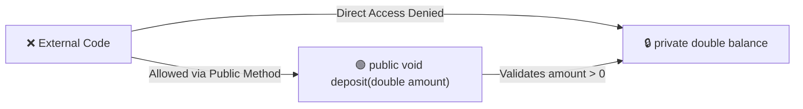
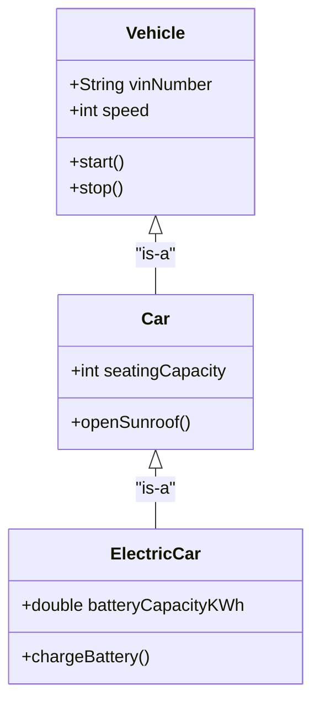
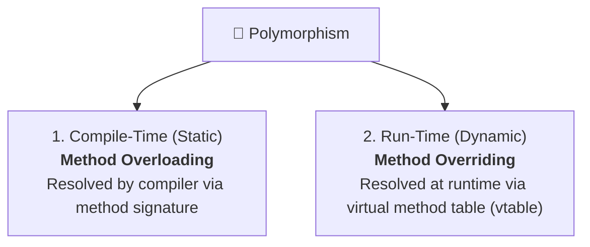

# Object-Oriented Programming (OOP) & Paradigm Evolution

> **TL;DR:** Programming evolved from hardware-bound Machine Code and Assembly to step-by-step Procedural code, and finally to Object-Oriented Programming (OOP). OOP organizes software around real-world entities that bundle **state (characteristics)** and **behavior (methods)** into a **class (blueprint)**. Its four pillars—**Abstraction, Encapsulation, Polymorphism, and Inheritance**—form the backbone of modular, scalable Low-Level Design (LLD).

---

## ⏳ The Evolution of Programming Paradigms



### Why Older Paradigms Failed at Scale

1. **Machine Language (Binary `00101011`):**
   - Directly executed by CPU circuitry.
   - **Failure Point:** Completely unreadable, zero portability, error-prone, impossible to maintain beyond microscopic programs.
2. **Assembly Language (`MOV AX, BX`):**
   - Introduced human-readable mnemonics mapped 1-to-1 with CPU instructions.
   - **Failure Point:** Tightly bound to physical CPU architecture (x86 vs ARM). Lack of high-level abstractions; no scalable way to build complex business logic.
3. **Procedural Programming (C, Pascal, Fortran):**
   - Introduced reusable functions, loops, and control flow blocks.
   - Emphasized: *"Do this step, then do that step"* (action-oriented).
   - **Failure Point:**
     - **No Real-World Domain Modeling:** Real systems are networks of communicating entities, not isolated global functions.
     - **Lack of Data Security (State Exposure):** Data and functions were detached. Global state was freely mutable, causing unpredictable side effects in large teams.
     - **Tight Coupling & Poor Reusability:** Modifying a shared data structure required rewriting every function touching that structure.

---

## 🧱 What is an Object? (Blueprint vs. Instance)

An **Object** is a software representation of a real-world entity defined by two attributes:
- **Characteristics (State / Data):** What the object *knows* (stored in fields/variables).
- **Behavior (Actions / Methods):** What the object *does* (executed via functions/methods).

A **Class** serves as the abstract blueprint, while an **Object** is the concrete instance allocated in memory.



---

## 🏛️ The 4 Core Pillars of OOP



---

### 1. 🎭 Abstraction (Hiding Complexity Behind an Interface)

Abstraction means exposing **what** an object does while concealing **how** it does it. 

- **Real-World Analogy:** You press the start button or turn the ignition key in a car. You do not need to know the fuel injection timing, spark plug firing sequence, or air-fuel ratio.
- **In Software Design:** We define interfaces or abstract classes that define contracts. The caller relies only on the interface, allowing the implementation to change without breaking client code.



```java
// Abstraction: Caller only knows the contract
public interface PaymentGateway {
    PaymentResult processPayment(double amount, String currency);
}

// Concrete implementations hide the complex vendor protocols
public class StripeGateway implements PaymentGateway {
    @Override
    public PaymentResult processPayment(double amount, String currency) {
        // Complex HTTP payload, cryptographic signatures, TLS handshakes
        return executeStripeCharge(amount, currency);
    }
}
```

---

### 2. 📦 Encapsulation (Information Hiding & State Protection)

Encapsulation is the bundling of data and the methods that operate on that data into a single unit (class), while **restricting direct access** to some of the object's components (using access modifiers like `private`, `protected`).

- **Real-World Analogy:** A car's fuel tank is not an open bucket anyone can pour liquid into. It has a sealed cap and a fuel gauge mechanism that guarantees only valid fuel enters and prevents hazardous spills.
- **Why It Matters:** 
  - Prevents external code from mutating an object into an invalid or corrupted state.
  - Ensures data validation and thread-safe boundaries.



```java
public class BankAccount {
    // Encapsulation: State is private and protected from corruption
    private double balance;

    public BankAccount(double initialBalance) {
        if (initialBalance < 0) throw new IllegalArgumentException("Negative initial balance");
        this.balance = initialBalance;
    }

    // Invariants enforced through methods
    public synchronized void withdraw(double amount) {
        if (amount <= 0) throw new IllegalArgumentException("Invalid withdrawal amount");
        if (amount > this.balance) throw new IllegalStateException("Insufficient funds");
        this.balance -= amount;
    }

    public double getBalance() {
        return this.balance;
    }
}
```

---

### 3. 🧬 Inheritance (Hierarchical Code Sharing)

Inheritance is the mechanism by which one class acquires the properties and behaviors of another class, establishing an **"is-a"** relationship.

- **Real-World Analogy:** A `Car` is a `Vehicle`. A `Truck` is a `Vehicle`. Both inherit common attributes like `vinNumber`, `speed`, and behaviors like `accelerate()`, but customize their specific mechanics.
- **Benefits:** Code reusability and natural hierarchical taxonomies.



> [!WARNING]
> **Modern LLD Rule: Prefer Composition over Inheritance.**
> Deep inheritance trees (e.g. 5+ levels) cause the **Fragile Base Class Problem** (modifying a base class silently breaks dozens of descendants). Modern systems use inheritance primarily for subtyping (interfaces), favoring composition (`has-a`) for code reuse.

---

### 4. 🦎 Polymorphism (Many Forms)

Polymorphism allows objects of different classes to be treated as objects of a common superclass, executing the appropriate behavior dynamically at runtime.

There are two primary types:



#### A. Compile-Time Polymorphism (Method Overloading)
Methods in the same class share the same name but have different parameter lists (types, number of arguments):
```java
public class Calculator {
    public int add(int a, int b) { return a + b; }
    public double add(double a, double b) { return a + b; }
    public String add(String a, String b) { return a + b; }
}
```

#### B. Runtime Polymorphism (Method Overriding)
A subclass provides a specific implementation of a method already defined in its parent class or interface:
```java
public interface Notification {
    void send(String message);
}

public class EmailNotification implements Notification {
    @Override
    public void send(String message) { /* Send via SMTP */ }
}

public class SmsNotification implements Notification {
    @Override
    public void send(String message) { /* Send via Twilio */ }
}

// Client executes polymorphically without knowing concrete type
public void notifyUser(Notification notifier, String msg) {
    notifier.send(msg); // Resolved dynamically at runtime
}
```

---

## ⚖️ Paradigm & Pillar Comparison Matrices

### Procedural vs. Object-Oriented Programming

| Dimension | 📋 Procedural Programming | 🏛️ Object-Oriented Programming |
| :--- | :--- | :--- |
| **Primary Unit** | Functions / Procedures | Classes & Objects |
| **Focus** | How to do things (Step-by-step logic) | Who does what (Entities & Interactions) |
| **Data Security** | Weak (Data is often global or openly passed) | Strong (Encapsulated with access modifiers) |
| **Real-World Mapping**| Poor (Abstract mathematical procedures) | Intuitive (Direct domain entity modeling) |
| **Extensibility** | Low (Modifying data affects all functions) | High (New classes implement existing interfaces) |
| **Memory Allocation**| Stack-heavy, raw pointers/structs | Heap-allocated objects with managed references |

### Abstraction vs. Encapsulation

| Dimension | 🎭 Abstraction | 📦 Encapsulation |
| :--- | :--- | :--- |
| **Core Intent** | **Hiding complexity** (What it does) | **Hiding internal state** (How it protects itself) |
| **Implementation** | Interfaces, Abstract Classes | Access modifiers (`private`, `protected`), Getters/Setters |
| **Perspective** | Outside-in (What caller sees) | Inside-out (How data integrity is preserved) |
| **Example** | `car.drive()` hides engine physics | `private double fuelLevel` prevents illegal values |

---

## 🏭 Real-World Production Applications

1. **Payment Orchestrators (Stripe / Adyen):**
   - **Polymorphism & Abstraction:** A checkout service interacts with a generic `PaymentProcessor` interface. At runtime, the Strategy pattern resolves to `ApplePayProcessor`, `CreditCardProcessor`, or `KlarnaProcessor` without changing billing workflow code.
2. **Cloud Storage Drivers (AWS S3 / Google Cloud Storage / Azure Blob):**
   - Application services code against a unified `BlobStorage` interface (`upload`, `download`, `delete`). Infrastructure teams can swap S3 for MinIO in local dev environments via runtime polymorphism.
3. **Database Drivers (JDBC / ODBC):**
   - JDBC provides a standard abstraction layer (`Connection`, `Statement`, `ResultSet`). Whether connecting to PostgreSQL, MySQL, or Oracle, client code remains identical.

---

## 💡 Interview Tips, Gotchas & Pitfalls

### 🚩 Classic Gotchas & Red Flags
1. **Confusing Abstraction with Encapsulation:**
   - *Pitfall:* Saying they are the same thing.
   - *Correction:* Abstraction solves design-level complexity (*"What should the user know?"*); Encapsulation solves implementation-level protection (*"How do I prevent unwanted tampering with my variables?"*).
2. **The "Getter/Setter" Trap (Anemic Domain Model):**
   - Generating public getters and setters for every private variable defeats encapsulation. It turns objects into dumb data bags with procedural code operating on them from the outside.
3. **Deep Inheritance Pitfall:**
   - Prefer **Composition (`has-a`)** over **Inheritance (`is-a`)**. Instead of `Car extends FlyingMachine`, use `Car has an Engine` and `Car has a FlightController`.

### 🎯 Interview Checklist
- [x] Can you explain why Procedural programming breaks down as codebases scale to millions of lines?
- [x] Can you clearly delineate the difference between compile-time and runtime polymorphism?
- [x] Can you explain how the 4 pillars lead directly into SOLID design principles?
