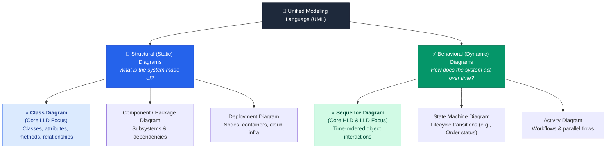
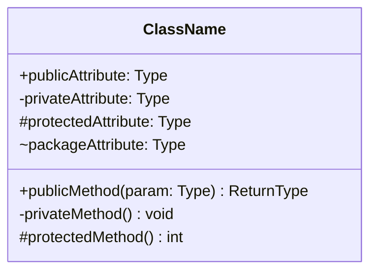
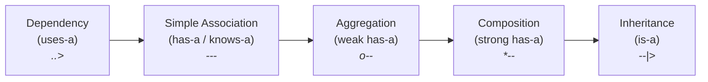
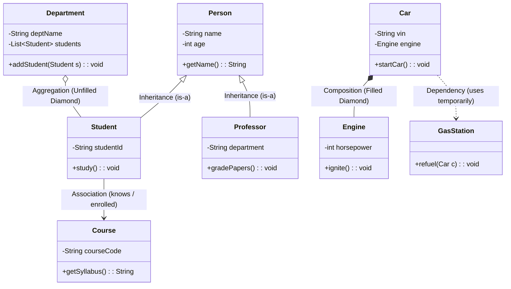
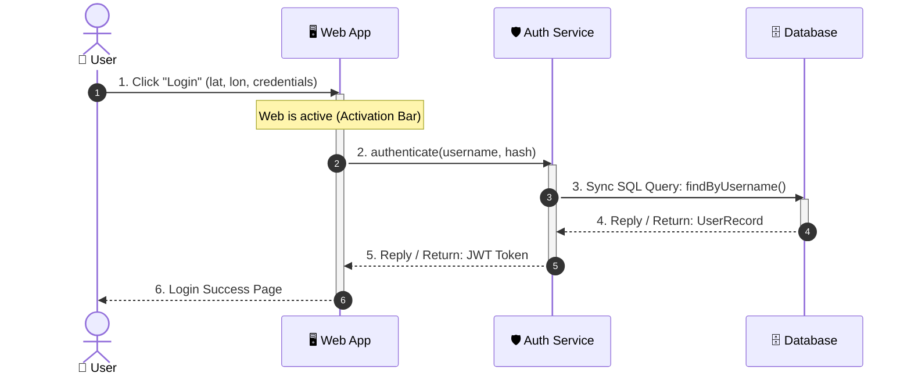
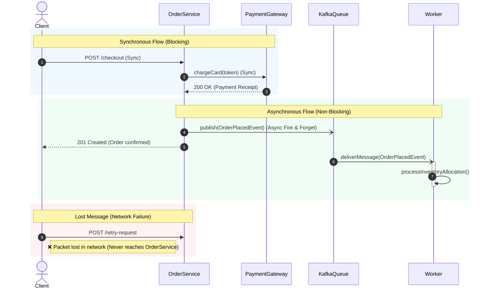
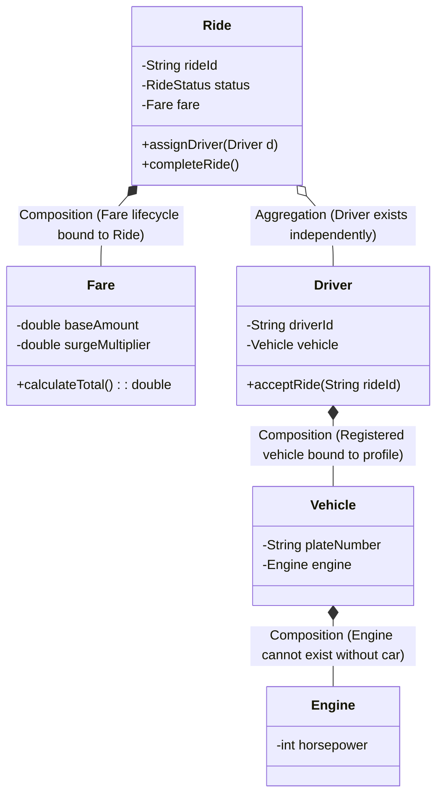

# UML Diagrams: Class Diagrams & Sequence Diagrams in System Design

> **TL;DR:** Unified Modeling Language (UML) standardizes system architecture communication. Rather than wading through ambiguous paragraphs of text, engineers use **Class Diagrams** (Structural/Static) to model entities, attributes, methods, and relationships, and **Sequence Diagrams** (Behavioral/Dynamic) to visualize how these objects interact over time via synchronous and asynchronous messages.

---

## 🗺️ UML Taxonomy: Structural vs. Behavioral

In software architecture and system design interviews, UML is split into two primary categories:

---

## 🧱 1. Class Diagrams (Structural Modeling)

A **Class Diagram** provides a static blueprint of a system by showing the classes, their data members (state), member functions (behavior), and how they are associated with one another.

### Anatomical Structure of a Class Box

Every class box consists of three stacked compartments:

1. **Top Compartment (Name):** Class identifier. 
   - Abstract classes use italics or stereotype: `<<abstract>> ClassName`.
   - Interfaces use: `<<interface>> InterfaceName`.
2. **Middle Compartment (Attributes / State):** Format: `visibility name: type`.
3. **Bottom Compartment (Methods / Behavior):** Format: `visibility methodName(parameter: type): returnType`.

### Access Modifier Legend

| Symbol | Modifier | Visibility Scope |
| :---: | :--- | :--- |
| `+` | **Public** | Accessible by any outside class or package. |
| `-` | **Private** | Accessible *only* within the declaring class. |
| `#` | **Protected** | Accessible within the class, its package, and subclasses. |
| `~` | **Package / Default** | Accessible only within classes of the same package. |

---

### Class & Object Relationships Spectrum

Understanding relationships is the difference between passing and failing a Low-Level Design (LLD) interview:

#### Detailed Breakdown of Relationships:

1. **Inheritance (`is-a`):**
   - **Symbol:** Solid line with hollow triangular arrowhead (`<|--`).
   - **Nature:** Class-level association. Subclass inherits attributes and methods of superclass.
   - **Example:** `Student` **is-a** `Person`.

2. **Composition (`has-a`, Strong Ownership / Lifetime Bound):**
   - **Symbol:** Solid line with a **filled black diamond** (`*--`).
   - **Lifecycle Rule:** The child **cannot exist** without the parent. If the parent object is destroyed, the child object is destroyed alongside it.
   - **Example:** A `Car` has an `Engine`. An `Engine` has no independent existence outside a car.

3. **Aggregation (`has-a`, Weak Ownership / Independent Lifetime):**
   - **Symbol:** Solid line with an **unfilled / hollow diamond** (`o--`).
   - **Lifecycle Rule:** The child **can exist** without the parent. If the parent object is destroyed, the child object continues to exist.
   - **Example:** A `Department` has a list of `Student`s. If the `Department` shuts down, the students still exist at the university.

4. **Simple Association (`knows-a` / `associated-with`):**
   - **Symbol:** Plain solid line (`---`) or directed arrow (`-->`).
   - **Lifecycle Rule:** Loose relationship where one class maintains a reference to another.
   - **Example:** `Student` enrolls in `Course`.

5. **Dependency (`uses-a`):**
   - **Symbol:** Dashed arrow line (`..>`).
   - **Lifecycle Rule:** Transient usage (e.g., passed as a method argument or local variable).
   - **Example:** `Car` temporarily uses `GasStation` during `refuel()`.

---

## ⚡ 2. Sequence Diagrams (Behavioral Modeling)

A **Sequence Diagram** models dynamic behavior by illustrating how processes and objects exchange messages chronologically along a vertical timeline.

### Core Visual Elements

### Key Components Explained:

1. **Lifeline (Vertical Dashed Line):**
   - Represents the continuous existence of an object over time.
   - Time moves **top to bottom**.
2. **Focus of Control / Activation Bar (Vertical Rectangle):**
   - Indicates the period during which an object is actively performing an operation or waiting for a delegated subroutine.
3. **Synchronous Call (`->>`):**
   - Solid line with filled arrow. Sender halts execution and blocks until a reply is received.
4. **Reply / Return Message (`-->>`):**
   - Dashed line with arrowhead. Carries return value or execution control back to caller.
5. **Asynchronous Call (`-)`):**
   - Solid line with open arrowhead. Non-blocking fire-and-forget. Sender does **not** wait for response before proceeding.
6. **Object Creation (`create`):**
   - Directed arrow leading directly to a new object rectangle box being instantiated.
7. **Object Destruction (`destroy` / `X`):**
   - Large `X` placed at the bottom of a lifeline indicating that the object has been garbage collected or deallocated.
8. **Lost & Found Messages:**
   - **Lost Message (`●--x`):** Message was transmitted into network but dropped before reaching the receiver (network packet drop, timeout).
   - **Found Message (`o->`):** Message arrives at an actor from an outside/unknown boundary outside the modeled system.

---

## 🔍 Deep-Dive: Sync vs. Async & Message Topologies

---

## ⚖️ Architectural Comparison Matrices

### Composition vs. Aggregation vs. Simple Association

| Criterion | 🔒 Composition (`*--`) | 🔓 Aggregation (`o--`) | 🔗 Simple Association (`---`) |
| :--- | :--- | :--- | :--- |
| **Relationship** | Whole-Part (Strict) | Whole-Part (Loose) | Peer-to-Peer / User-Resource |
| **Ownership** | **Strong ownership** | **Weak ownership** | No direct ownership |
| **Lifecycle Coupling**| **Coupled**. Child destroyed with parent | **Independent**. Child survives parent | **Independent**. Both survive |
| **UML Symbol** | Filled / Solid Black Diamond | Hollow / Unfilled Diamond | Plain Line or Directed Arrow |
| **Code Representation**| Initialized inside constructor | Passed via setter or method injection | Local reference / foreign key |
| **Example** | `Order` $\to$ `OrderLineItem` `House` $\to$ `Room` | `Department` $\to$ `Teacher` `Playlist` $\to$ `Song` | `Driver` $\to$ `Passenger` `Student` $\to$ `Course` |

### Synchronous vs. Asynchronous Messages

| Dimension | ⏱️ Synchronous Message (`->>`) | ⚡ Asynchronous Message (`-)`) |
| :--- | :--- | :--- |
| **Thread Behavior** | Sender blocks waiting for reply | Sender continues immediately without blocking |
| **Coupling** | High temporal coupling | Low temporal coupling (Decoupled) |
| **Error Handling** | Direct error codes / exceptions | Dead letter queues, retries, idempotency tokens |
| **Latency** | Cumulative sum of downstream calls | Minimum latency (Enqueue operation only) |
| **Typical Protocols**| HTTP/1.1, gRPC, REST, JDBC | Kafka, RabbitMQ, AWS SQS, Webhooks |

---

## 🏭 Real-World Production Example: Ride-Hailing Booking

Let's observe both diagrams working together to model a ride-hailing checkout:

### Class Model (LLD)

---

## 💡 System Design Interview Tips & Common Pitfalls

### 🚩 Red Flags Interviewers Watch For
1. **Inverting Composition and Aggregation:**
   - *Trap:* Claiming a `Room` has an aggregation relationship with a `Building`. If the building is demolished, the rooms cease to exist—it is strict **Composition**.
   - *Trap:* Claiming an `Author` is composed within a `Book`. If a book goes out of print, the author still lives—it is **Aggregation** or **Association**.
2. **Missing Activation Bars in Sequence Diagrams:**
   - Drawing messages connecting directly to lifelines without activation bars makes it impossible to see concurrency bottlenecks and deadlocks.
3. **Using Synchronous Arrows for Event-Driven Systems:**
   - In Kafka/RabbitMQ architectures, always use open-arrow asynchronous notations (`-)`) rather than blocking request-response arrows.

### 🏆 Quick Interview Sketching Rules
- **Class Diagrams:** When asked for LLD, start with 3–5 core nouns (Classes), write 2 attributes and 2 methods each, and immediately define their relationship diamonds (`*--` vs `o--`).
- **Sequence Diagrams:** Focus on the "Happy Path" first with step numbers. Use an `alt` or `opt` box for error/fallback scenarios.

