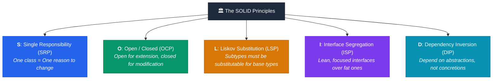
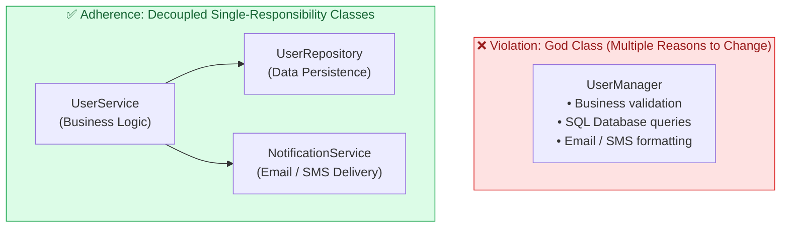
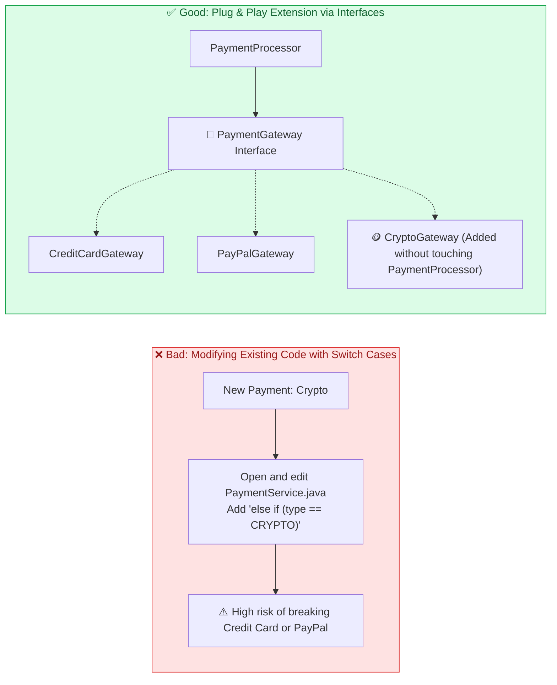
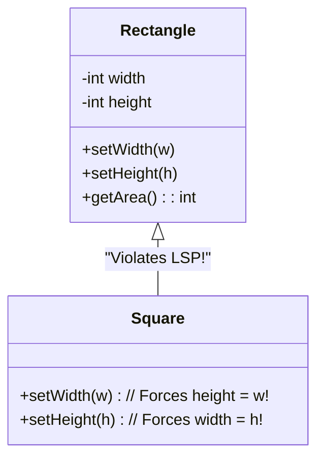
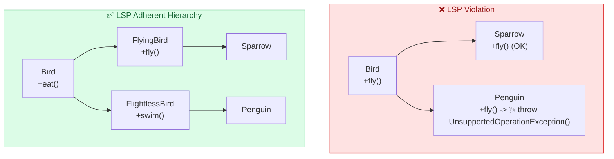
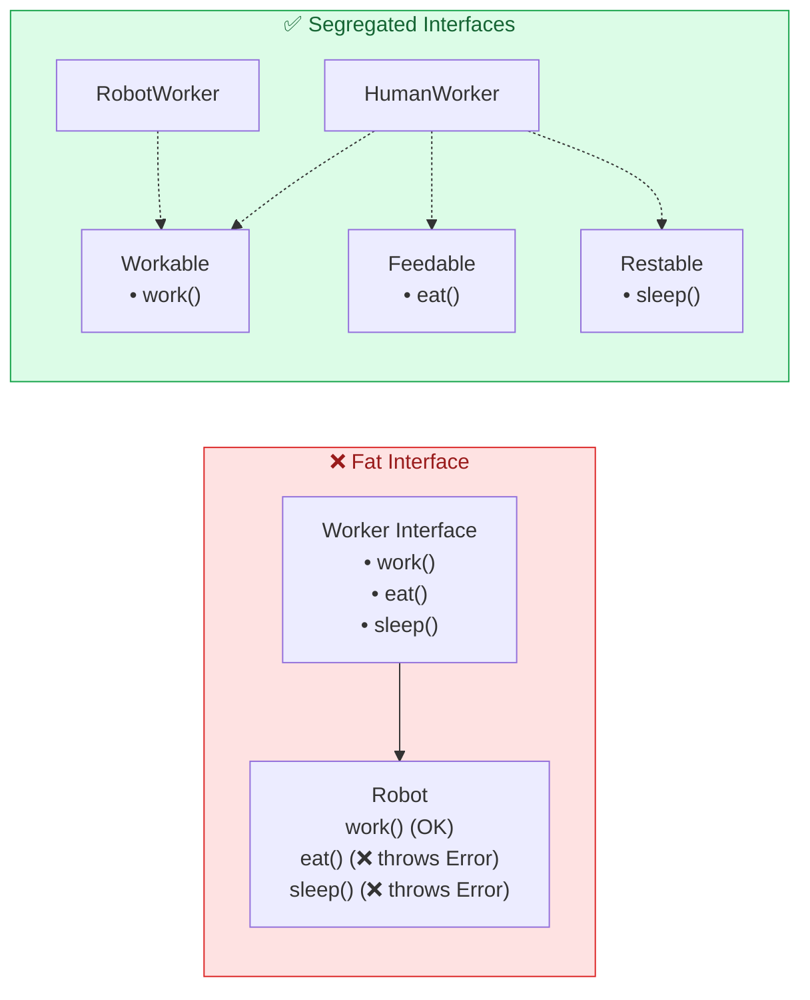
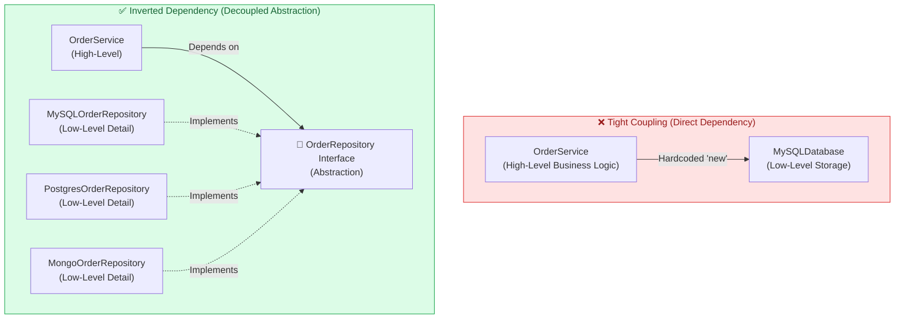

# The SOLID Design Principles: Architecture & Low-Level Design (LLD)

> **TL;DR:** Software systems degrade over time due to code rot, tight coupling, and "shotgun surgery" (changing one requirement breaks five other files). The **SOLID principles** provide five foundational design rules that ensure code is **maintainable, readable, extensible, and robust** as team and feature complexity scale.

---

## 🧭 The 5 Pillars of SOLID



---

## 1. 🎯 Single Responsibility Principle (SRP)

> *"A class should have one, and only one, reason to change."* — Robert C. Martin (Uncle Bob)

### The Problem: The "God Object" Anti-Pattern
When a class juggles business logic, database persistence, and notification formatting, changes to any of these three concerns force edits to the same file, introducing merge conflicts and regression bugs.



### Code Refactoring (SRP)

#### ❌ Violation:
```java
// Multiple responsibilities: User state + DB operations + Email delivery
public class Invoice {
    private double amount;

    public void calculateTotal() { /* Calculation logic */ }
    public void saveToDatabase() { /* Direct SQL INSERT */ }
    public void sendEmailConfirmation() { /* SMTP connection */ }
}
```

#### ✅ Refactored to SRP:
```java
// 1. Pure domain entity
public class Invoice {
    private double amount;
    public double calculateTotal() { return amount * 1.18; }
}

// 2. Dedicated persistence responsibility
public class InvoiceRepository {
    public void save(Invoice invoice) { /* SQL queries */ }
}

// 3. Dedicated notification responsibility
public class InvoiceNotifier {
    public void sendEmail(Invoice invoice) { /* Email dispatch */ }
}
```

---

## 2. 🔌 Open / Closed Principle (OCP)

> *"Software entities (classes, modules, functions) should be open for extension, but closed for modification."*

You should be able to introduce new behavior or features **without altering existing, tested source code**.



### Code Refactoring (OCP)

#### ❌ Violation:
```java
public class PaymentService {
    public void processPayment(String type, double amount) {
        if (type.equals("CREDIT_CARD")) {
            // charge credit card
        } else if (type.equals("PAYPAL")) {
            // charge paypal
        } else if (type.equals("CRYPTO")) { 
            // ❌ Modified existing class to add crypto!
        }
    }
}
```

#### ✅ Refactored to OCP (Strategy Pattern):
```java
public interface PaymentMethod {
    void pay(double amount);
}

public class CreditCardPayment implements PaymentMethod {
    public void pay(double amount) { /* Credit card charge */ }
}

public class CryptoPayment implements PaymentMethod {
    public void pay(double amount) { /* Bitcoin/Ethereum transaction */ }
}

// Closed for modification: Never needs to change when a new method is added!
public class PaymentProcessor {
    public void executePayment(PaymentMethod method, double amount) {
        method.pay(amount);
    }
}
```

---

## 3. 🧬 Liskov Substitution Principle (LSP)

> *"Objects of a superclass should be replaceable with objects of its subclasses without breaking application correctness or violating assumptions."* — Barbara Liskov

If class $S$ is a subtype of class $T$, then objects of type $T$ can be replaced with objects of type $S$ without altering desirable properties of the program.

### The Classic Pitfall: Rectangle vs. Square



If code expects a `Rectangle` and calls `rect.setWidth(5); rect.setHeight(10);`, it expects `rect.getArea() == 50`. But if a `Square` is passed, `setHeight(10)` also forces the width to 10, resulting in an area of 100, silently violating program invariants!

### The Bird That Cannot Fly Violation



#### ✅ Refactored Code (LSP):
```java
// Base abstract contract with universal guarantees
public abstract class Bird {
    public abstract void eat();
}

public interface Flyable {
    void fly();
}

public class Sparrow extends Bird implements Flyable {
    public void eat() { System.out.println("Sparrow pecking seeds"); }
    public void fly() { System.out.println("Sparrow soaring"); }
}

public class Penguin extends Bird {
    public void eat() { System.out.println("Penguin catching fish"); }
    // No fly() method forced upon Penguin!
}
```

---

## 4. ✂️ Interface Segregation Principle (ISP)

> *"Clients should not be forced to depend upon interfaces that they do not use."*

Prefer many **small, client-specific interfaces** over a single **fat / bloated "general-purpose" interface**.



### Code Refactoring (ISP)

#### ❌ Violation:
```java
public interface MultiFunctionPrinter {
    void print(Document doc);
    void scan(Document doc);
    void fax(Document doc);
}

// Simple office printer is forced to provide empty / throwing methods for fax & scan!
public class BasicPrinter implements MultiFunctionPrinter {
    public void print(Document doc) { /* Print logic */ }
    public void scan(Document doc) { throw new UnsupportedOperationException(); }
    public void fax(Document doc) { throw new UnsupportedOperationException(); }
}
```

#### ✅ Refactored to ISP:
```java
public interface Printer {
    void print(Document doc);
}

public interface Scanner {
    void scan(Document doc);
}

public interface Fax {
    void fax(Document doc);
}

// Basic printer only implements what it actually supports
public class BasicPrinter implements Printer {
    public void print(Document doc) { System.out.println("Printing..."); }
}

// Enterprise printer implements all relevant segregated interfaces
public class AllInOneOfficeHub implements Printer, Scanner, Fax {
    public void print(Document doc) { /* ... */ }
    public void scan(Document doc) { /* ... */ }
    public void fax(Document doc) { /* ... */ }
}
```

---

## 5. 🔄 Dependency Inversion Principle (DIP)

> *"High-level modules should not depend on low-level modules. Both should depend on abstractions. Abstractions should not depend on details. Details should depend on abstractions."*

DIP decouples high-level policy (core business logic) from low-level plumbing (databases, third-party APIs, hardware).



### Code Refactoring (DIP)

#### ❌ Violation:
```java
public class MySQLDatabase {
    public void insert(String sql) { /* Raw DB call */ }
}

public class OrderService {
    // ❌ Tightly coupled to concrete MySQL class via 'new' keyword
    private MySQLDatabase database = new MySQLDatabase();

    public void createOrder(Order order) {
        database.insert("INSERT INTO orders...");
    }
}
```

#### ✅ Refactored to DIP (using Dependency Injection):
```java
// 1. High-level abstraction
public interface OrderRepository {
    void save(Order order);
}

// 2. Low-level concrete implementations
public class PostgresOrderRepository implements OrderRepository {
    public void save(Order order) { /* Postgres SQL */ }
}

public class DynamoDBOrderRepository implements OrderRepository {
    public void save(Order order) { /* AWS NoSQL putItem */ }
}

// 3. High-level module depends only on abstraction (Injected via constructor)
public class OrderService {
    private final OrderRepository repository;

    public OrderService(OrderRepository repository) { // Dependency Injection
        this.repository = repository;
    }

    public void createOrder(Order order) {
        repository.save(order);
    }
}
```

---

## ⚖️ SOLID Architectural Cheat Sheet & Anti-Patterns

| Letter | Principle | Primary Goal | Code Smell / Red Flag | Best Fix / Design Pattern |
| :---: | :--- | :--- | :--- | :--- |
| **S** | **Single Responsibility** | High Cohesion | Monolithic 2,000-line class, "God Object" | Extract Class, Facade Pattern |
| **O** | **Open / Closed** | Extensibility without breaking changes | Massive `if-else` or `switch` statements checking types | Strategy, Factory Method, Decorator |
| **L** | **Liskov Substitution** | Behavioral Subtyping | Subclass throwing `UnsupportedOperationException` | Composition, Separate Interfaces |
| **I** | **Interface Segregation** | Decoupled contracts | Classes with empty dummy implementations | Split into smaller, targeted interfaces |
| **D** | **Dependency Inversion** | Low Coupling, Testability | Hardcoded `new ConcreteClass()` in business logic | Dependency Injection (DI), Inversion of Control (IoC) |

---

## 🏭 Real-World Production Implementations

1. **Spring Framework / NestJS (Dependency Injection & DIP):**
   - Inversion of Control (IoC) containers instantiate and inject dependencies at runtime (`@Autowired`, `@Injectable`). You never write `new DatabaseConnection()` inside a controller.
2. **Standard POSIX File System Abstraction (OCP & ISP):**
   - The Linux Virtual File System (VFS) defines small, targeted function pointers (`read`, `write`, `seek`, `ioctl`). Any file system (ext4, ZFS, NFS) implements this interface, making Linux open for new storage formats without kernel rewrites.
3. **Logging Libraries (SLF4J / Log4j2) (DIP & OCP):**
   - Applications log against the abstract `org.slf4j.Logger` interface. The underlying engine (Logback, Log4j2, Console) can be swapped via classpath configuration without touching a single line of business code.

---

## 💡 System Design & LLD Interview Tips

### 🚩 Top 3 Interview Pitfalls
1. **Confusing DIP with DI:**
   - **DIP (Dependency Inversion Principle)** is the *architectural principle* (depend on abstractions).
   - **DI (Dependency Injection)** is the *implementation pattern* (passing dependencies via constructor/setter).
2. **Over-Engineering (The "Interface for Everything" Trap):**
   - Do not create an interface for a class that will only ever have one implementation unless required for unit testing or future pluggability. Balance SOLID with **YAGNI** (*You Aren't Gonna Need It*).
3. **Failing to Spot LSP in Object Hierarchies:**
   - If an interviewer asks to model birds, geometric shapes, or payment methods, immediately consider whether a subclass could fail to honor the base class's invariants.
