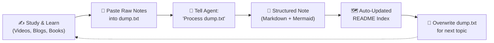

# System Design Knowledge Base & Study Notes 🚀

Welcome to your personal System Design study repository! This repository is designed to turn raw learning dumps into comprehensive, production-grade system design reference notes with structured explanations, architectural Mermaid diagrams, trade-off analyses, and interview-ready summaries.

---

## 🔄 How the Notes Workflow Works



1. **Dump:** As you read books (e.g. *Designing Data-Intensive Applications*, *Alex Xu System Design Interview*), watch videos, or read engineering blogs, paste your raw, unstructured notes into [`dump.txt`](./dump.txt).
2. **Convert:** Ask the AI agent:
   > *"Convert the contents of dump.txt into a complete note."*
3. **Persist & Index:** The agent will:
   - Identify the topic category.
   - Generate a rich, formatted note with Mermaid diagrams, trade-offs, and examples.
   - Place it in the appropriate folder under a clean filename.
   - Update this `README.md` index and check off topics.
4. **Repeat:** Overwrite [`dump.txt`](./dump.txt) for your next session.

---

## 📚 System Design Roadmap & Learning Index

### 0. Interview Framework & Foundations
- [x] [`00-system-design-interview-guide.md`](./00-framework/00-system-design-interview-guide.md) — 4-Step Framework (Scope, High-Level, Deep Dive, Wrap-up)
- [ ] Back-of-the-envelope calculations & numbers every engineer should know
- [ ] Latency comparison numbers (L1 cache vs RAM vs SSD vs Network)

### 1. Networking & Communication
- [ ] Client-Server Architecture & OSI / TCP-IP Models
- [ ] DNS, Anycast, and Domain Routing
- [ ] HTTP/1.1 vs HTTP/2 vs HTTP/3 (QUIC)
- [ ] Communication Protocols: REST vs gRPC vs GraphQL vs WebSockets vs SSE
- [ ] Forward Proxy vs Reverse Proxy

### 2. Scalability & Traffic Management
- [ ] Vertical vs Horizontal Scaling
- [ ] Load Balancers (L4 vs L7, Algorithms: Round Robin, Least Connections, Consistent Hashing)
- [ ] API Gateway & Reverse Proxies (Routing, SSL termination, Authentication)
- [ ] Rate Limiting & Throttling (Token Bucket, Leaky Bucket, Sliding Window Counter)

### 3. Caching & Content Delivery
- [ ] Caching Strategies (Cache-Aside, Write-Through, Write-Behind, Refresh-Ahead)
- [ ] Cache Eviction Policies (LRU, LFU, FIFO, ARC)
- [ ] Cache Pitfalls: Stampede / Dogpiling, Penetration, Avalanche
- [ ] Redis vs Memcached
- [ ] Content Delivery Networks (CDN) & Edge Computing

### 4. Databases & Storage Systems
- [ ] Relational (SQL) vs Non-Relational (NoSQL - Key-Value, Document, Wide-Column, Graph)
- [ ] Database Replication (Single-Leader, Multi-Leader, Leaderless)
- [ ] Database Partitioning & Sharding (Horizontal vs Vertical, Range vs Hash vs Consistent Hashing)
- [ ] ACID vs BASE
- [ ] Indexes under the hood: B-Trees vs LSM-Trees vs SSTables vs Inverted Indexes
- [ ] Distributed File Storage & Object Storage (S3, HDFS, Ceph)

### 5. Distributed Systems Core Theory
- [ ] The CAP Theorem & PACELC Theorem
- [ ] Consistency Models (Strong, Eventual, Causal, Read-Your-Writes)
- [ ] Consensus Protocols (Paxos, Raft)
- [ ] Distributed Transactions (2-Phase Commit, 3-Phase Commit, Saga Pattern)
- [ ] Distributed Unique ID Generation (Snowflake, UUIDv7, Ticket Servers)
- [ ] Distributed Locking (Redis Redlock, Zookeeper/etcd)

### 6. Asynchronous Processing & Messaging
- [ ] Message Queues vs Event Streams (RabbitMQ vs Apache Kafka vs AWS SQS)
- [ ] Delivery Guarantees (At-least-once, At-most-once, Exactly-once)
- [ ] Event-Driven Architecture, CQRS & Event Sourcing
- [ ] Batch Processing vs Stream Processing (Spark, Flink)

### 7. Reliability, Resiliency & Observability
- [ ] Fault Tolerance, Circuit Breakers & Retries with Exponential Backoff
- [ ] Bulkhead Pattern & Graceful Degradation
- [ ] Monitoring, Metrics, Distributed Tracing & Logging (Prometheus, Grafana, OpenTelemetry)
- [ ] High Availability (Active-Active vs Active-Passive, SLAs/SLOs/SLIs)

### 8. System Architecture Case Studies
- [ ] **URL Shortener** (e.g. TinyURL, Bitly)
- [ ] **Rate Limiter Service** (Distributed Rate Limiter)
- [ ] **Key-Value Store** (e.g. DynamoDB / Cassandra style)
- [ ] **Web Crawler** (Distributed, polite, deduplication)
- [ ] **Notification System** (Push, SMS, Email at scale)
- [ ] **Social Media Feed** (Twitter/X, Facebook News Feed - Fanout-on-write vs Fanout-on-read)
- [ ] **Chat / Messaging System** (WhatsApp, Slack, Discord)
- [ ] **Video Streaming Platform** (YouTube, Netflix - Video chunking, CDN, Transcoding)
- [ ] **Ride-Hailing / Geospatial Service** (Uber, Lyft - QuadTrees, Geohash, Google S2)
- [ ] **Collaborative Editing** (Google Docs, Figma - OT vs CRDTs)
- [ ] **E-Commerce Checkout & Flash Sale** (Inventory locking, payment processing)

---

## 🛠️ Repository Directory Structure

```text
system-design-/
├── README.md                              # Central roadmap, topic index, and tracker
├── AGENTS.md                              # AI configuration & note formatting rules
├── dump.txt                               # Scratchpad for pasting raw learning notes
├── 00-framework/                          # System design interview steps & math cheat-sheets
├── 01-networking-and-communication/       # Protocols, proxies, APIs
├── 02-scalability-and-traffic/            # Load balancing, rate limiting, gateways
├── 03-caching-and-cdn/                    # Caching patterns, Redis, CDN
├── 04-databases-and-storage/              # SQL vs NoSQL, sharding, replication, indexes
├── 05-distributed-systems/                # CAP, consensus, consistency, distributed locks
├── 06-messaging-and-events/               # Kafka, RabbitMQ, queues, event-driven
├── 07-reliability-and-observability/      # Circuit breakers, tracing, metrics
└── 08-case-studies/                       # Real-world system designs (TinyURL, Twitter, etc.)
```

---

## 📌 Note Template Standard

Every generated note in this repository follows a clean, standardized structure:
1. **Title & Summary Box** (High-level TL;DR)
2. **Core Problems & Motivation** (Why do we need this component?)
3. **Architecture & Visual Flow** (Rich Mermaid diagrams)
4. **Deep-Dive Concepts & Mechanics** (How it actually works under the hood)
5. **Trade-offs & Alternatives Matrix** (Pros, Cons, Latency, Complexity)
6. **Real-World Examples & Production Nuances** (How industry giants use it)
7. **System Design Interview Cheat Sheet** (Key questions, formulas, red flags)
